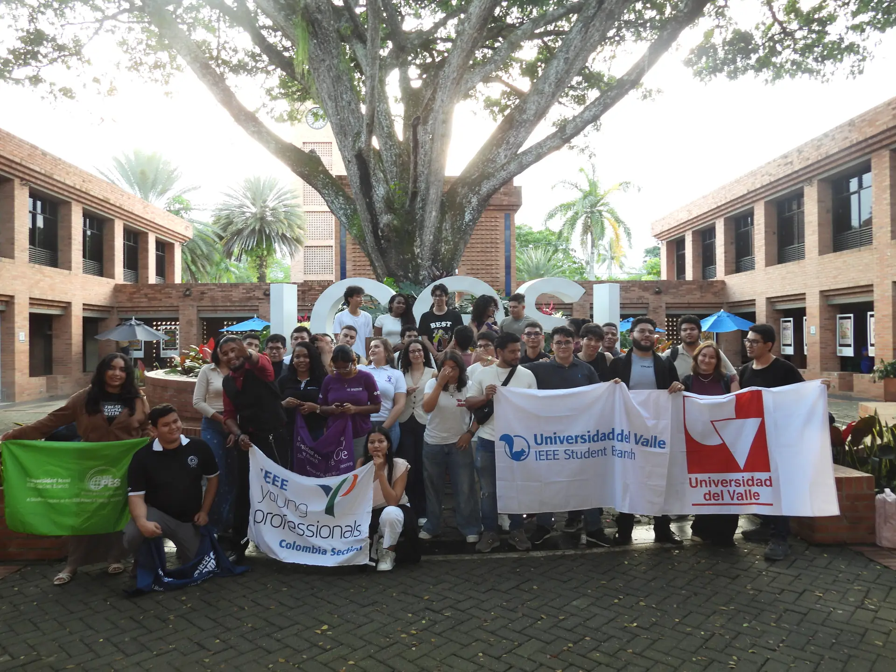

# ¿Qué es IEEE?

IEEE es una organización profesional sin ánimo de lucro dedicada al avance de la tecnología, con miembros y voluntarios en todo el mundo. Los estudiantes participan a través de las Ramas Estudiantiles de sus universidades. ¿Quieres unirte? Mira [Cómo unirse a IEEE](unirse.md).

Video corto: [All About IEEE Students](https://www.youtube.com/watch?v=H_UuN89Mu4Y) (IEEE Students).

## ¿Qué es una Rama Estudiantil?

Una **Rama Estudiantil** (Student Branch) es el grupo oficial de IEEE en una universidad. La forman al menos 12 estudiantes miembros de IEEE, la acompaña un profesor, el Consejero de Rama (Branch Counselor), y la dirige una junta de estudiantes, la junta directiva (Branch Officers). Organiza charlas, talleres, competencias y proyectos, y conecta a sus miembros con el resto de IEEE. Ver [Requisitos de una Rama](../operacion/requisitos.md). ¿Quieres [crear o reactivar una Rama](../operacion/requisitos.md#crear-rama)?

## ¿Y los Capítulos y Grupos de Afinidad?

Dentro de una Rama pueden existir unidades más pequeñas con un enfoque propio:

- **Capítulo** (Student Branch Chapter): reúne a estudiantes de una misma Sociedad técnica de IEEE, por ejemplo Computer Society, Robotics and Automation o Power & Energy.
- **Grupo de Afinidad** (Affinity Group): reúne a estudiantes alrededor de un interés común que no es técnico, como Women in Engineering (WIE) o SIGHT (tecnología para el desarrollo sostenible).

Ambos funcionan como comités de la Rama y necesitan al menos 6 miembros para crearse. Ver [Capítulos y Grupos de Afinidad](../operacion/capitulos.md).

{ loading=lazy }

## ¿Dónde encaja la Rama dentro de IEEE?

- **Rama Estudiantil**, con sus Capítulos y Grupos de Afinidad.
- **[Sección Colombia](seccion-colombia.md)**: agrupa a las Ramas del país, organizadas en cinco zonas: Antioquia, Centro, Eje Cafetero, Santanderes y Suroccidente ([mapa](https://www.google.com/maps/d/viewer?mid=1RM2Ua3vGE2Tw4CMoe3bfAZ0nLOAjCbE)). Su equipo de actividades estudiantiles es el SAC (Student Activities Committee) Colombia, que también organiza la Reunión Nacional de Ramas (RNR).
- **Región 9** (Latinoamérica): coordina a las Secciones de la región y tiene su propio SAC.
- **IEEE**, a través de Member and Geographic Activities (MGA), que define las reglas para todas las unidades en su Manual de Operaciones. Las unidades (Ramas, Capítulos, Secciones) se llaman OU (Organizational Unit).

Las siglas se explican en el [Glosario](glosario.md).

## Cursos introductorios

Cursos cortos del Center for Leadership Excellence (CLE) para entender IEEE. Necesitas tu cuenta IEEE. Para empezar:

- [Introduction to IEEE](https://ieee-elearning.org/course/view.php?id=239)
- [Introduction to IEEE Member & Geographic Activities MGA](https://ieee-elearning.org/course/view.php?id=240)
- [IEEE Code of Ethics](https://ieee-elearning.org/course/view.php?id=49)

Todos los demás, en [Cursos del CLE](../recursos/cursos-cle.md). Las siglas están en el [Glosario](glosario.md). ¿Dudas? Mira [¿A quién preguntar?](../recursos/contacto.md)
