# Reportar un evento en vTools

Cómo crear y publicar en vTools Events un evento que ya ocurrió, y cómo registrar su reporte de asistencia (obligatorio). Si todavía vas a organizarlo, empieza por [Organizar un evento](organizar-evento.md). Los datos de las capturas son de ejemplo.

!!! info ""

    **Antes de empezar:** inicia sesión con tu cuenta de IEEE, ten a la mano el código de tu unidad (en la Sección Colombia es **R90705**) y un correo de contacto (el del SAC Colombia es **sac@ieee.org.co**).

## 1. Crear el evento

1. En la página principal de vTools Events, haz clic en **Create Event** (el ícono verde con el signo +).
2. Se abre el formulario "Create an Event". Las secciones son Host, Details, Location, Registration & Payment, Speakers y Report and Attendance. Los campos con asterisco son obligatorios.

<figure markdown>
  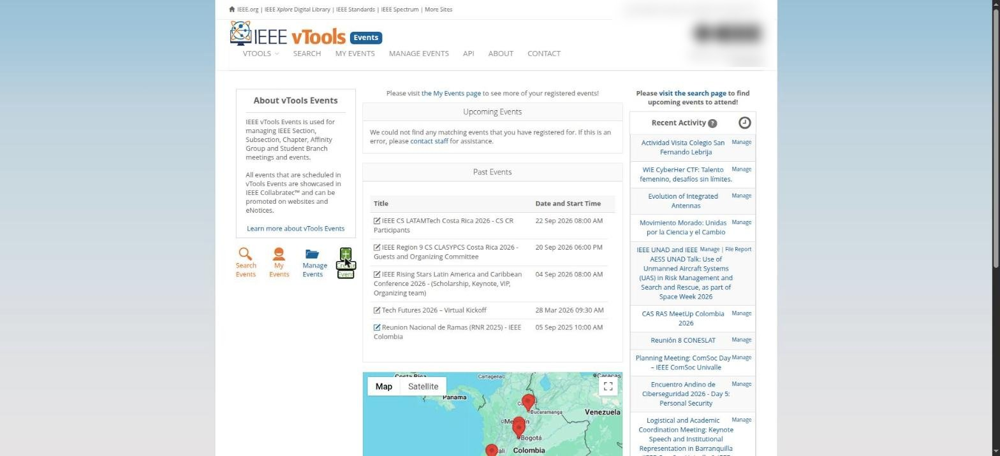{ loading=lazy }
  <figcaption>Botón Create Event en la página principal.</figcaption>
</figure>

<figure markdown>
  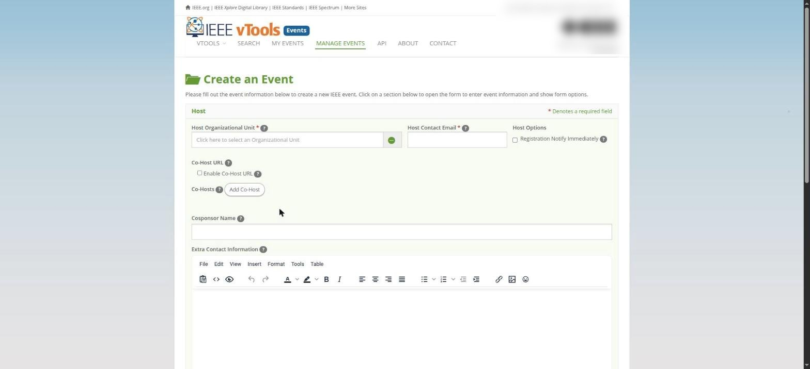{ loading=lazy }
  <figcaption>Formulario vacío de Create an Event.</figcaption>
</figure>

## 2. Sección Host

1. Haz clic en **Host Organizational Unit** y escribe el código de la unidad, por ejemplo `R90705`.
2. Elige la sugerencia correcta: **R90705 - Colombia Section**.
3. Si el evento lo organiza tu Rama, un Capítulo o un Grupo de Afinidad, busca y elige esa unidad como unidad anfitriona (Host Organizational Unit) en lugar de la Sección Colombia. Capítulos y Grupos: ver [Capítulos y Grupos de Afinidad](../capitulos/index.md).
4. En **Host Contact Email** escribe el correo de contacto. Confirma que quedó en el campo antes de seguir.

<figure markdown>
  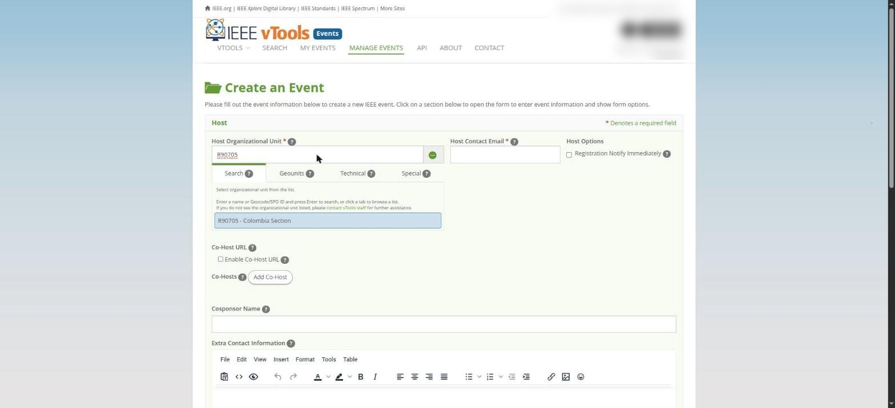{ loading=lazy }
  <figcaption>Sugerencias de unidad organizativa.</figcaption>
</figure>

<figure markdown>
  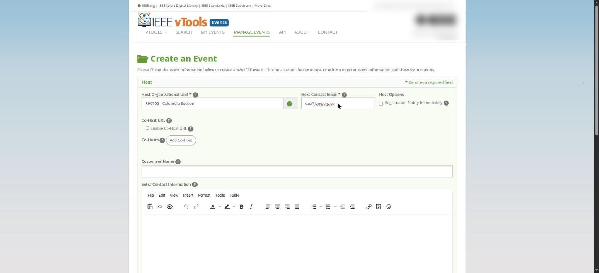{ loading=lazy }
  <figcaption>Sección Host con la unidad y el correo.</figcaption>
</figure>

## 3. Sección Details

Haz clic en **Details** para abrirla. Los campos obligatorios son:

| Campo | Ejemplo |
| --- | --- |
| Title | Reunión SAC 9 de Noviembre |
| Category y Sub-category | Nontechnical, Nontechnical (Other). Elige la subcategoría después de la categoría. |
| Start time y End time | 09 Nov 2026 08:00 PM y 09 Nov 2026 09:00 PM |
| Time Zone | (UTC-05:00) Bogota. Elígela de la lista desplegable. |
| Description | Resumen de lo que se hizo, en el editor de texto. |

Las etiquetas (Tags/Keywords) están más abajo, después de Header, Footer y Description.

<figure markdown>
  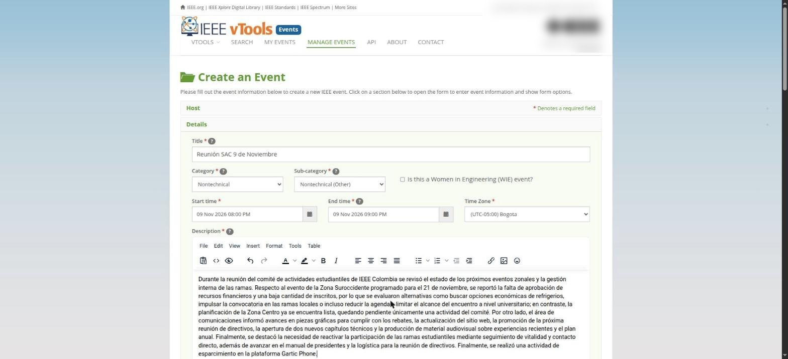{ loading=lazy }
  <figcaption>Sección Details con los campos obligatorios llenos.</figcaption>
</figure>

## 4. Sección Location

1. Por defecto aparece **In-Person**. Para una reunión virtual, elige **Virtual**.
2. En **Virtual Attendance Info** (obligatorio) escribe la información de acceso. vTools oculta este dato a los usuarios anónimos, así que puedes poner el link privado.

<figure markdown>
  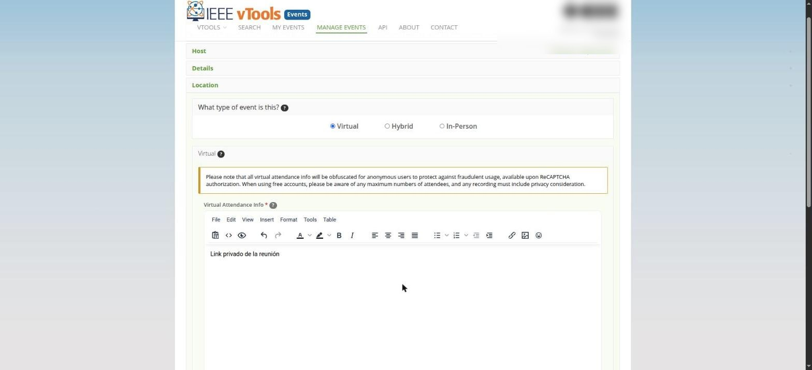{ loading=lazy }
  <figcaption>Location con Virtual y la información de asistencia.</figcaption>
</figure>

## 5. Speakers y Registration & Payment

1. Si no hubo ponentes, omite la sección Speakers.
2. En **Registration & Payment**, elige **None** si el evento no tuvo inscripción. Al elegirlo, la sección Payment muestra un aviso de que no hay cuenta comercial, y es lo esperado.

<figure markdown>
  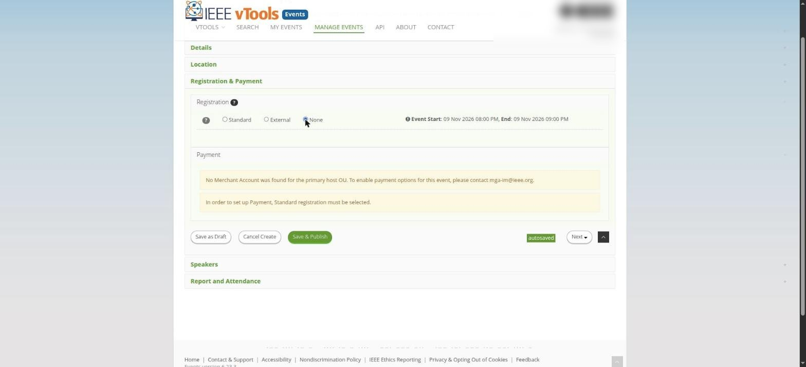{ loading=lazy }
  <figcaption>Registration con None seleccionado.</figcaption>
</figure>

## 6. Reportar la asistencia (obligatorio)

!!! danger ""

    Un evento publicado **no cuenta** para los reportes requeridos hasta que se agregue su reporte de asistencia. No des el evento por terminado sin este paso.

**Consejo:** puedes registrar la asistencia antes de publicar el evento, así queda completo desde el primer momento.

1. En la página de administración del evento, baja hasta **Reporting** y haz clic en **File Report**.
2. En **IEEE Attended** escribe el número de asistentes de IEEE. En **Guest Attended** escribe el número de invitados que no son de IEEE, o `0` si no hubo.
3. Revisa los dos números y haz clic en **Submit**.

<figure markdown>
  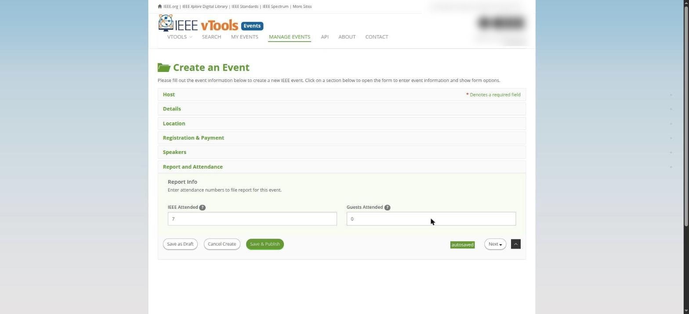{ loading=lazy }
  <figcaption>Sección Report and Attendance con 7 asistentes de IEEE y 0 invitados.</figcaption>
</figure>

<figure markdown>
  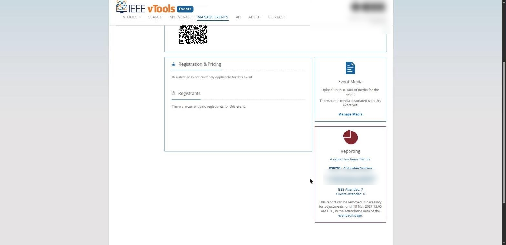{ loading=lazy }
  <figcaption>Reporte registrado: vTools muestra los números y permite corregirlos durante un tiempo.</figcaption>
</figure>

## 7. Publicar el evento

Baja hasta los botones de la parte inferior del formulario. **Save & Publish** publica el evento, así que revisa antes todos los datos. **Save as Draft** guarda sin publicar. Después de publicar, confirma en la página de administración que el reporte de asistencia quedó registrado.

<figure markdown>
  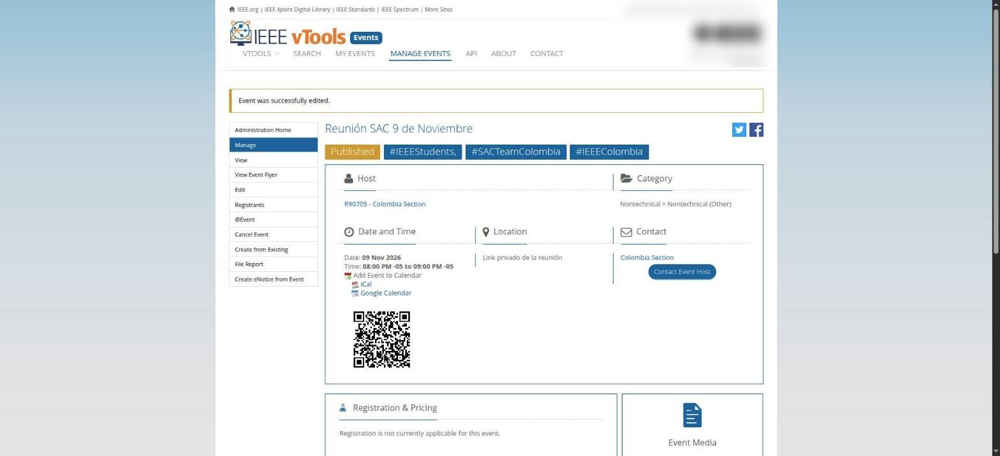{ loading=lazy }
  <figcaption>Página de administración después de publicar el evento.</figcaption>
</figure>

## Consejos

### Subir una foto del evento

Una foto sirve como registro para premios, reconocimientos e historia de la unidad.

1. En **Event Media** haz clic en **Manage Media**, luego en **Browse** y elige la foto. vTools la sube en ese momento.
2. Después de subirla, haz clic en **Edit** junto al archivo para escribir el título y la descripción. Si los escribes antes de subir, se pierden.

<figure markdown>
  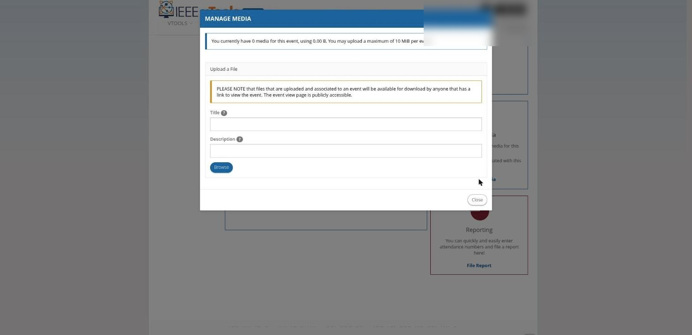{ loading=lazy }
  <figcaption>Diálogo Manage Media, con Browse para subir el archivo.</figcaption>
</figure>

<figure markdown>
  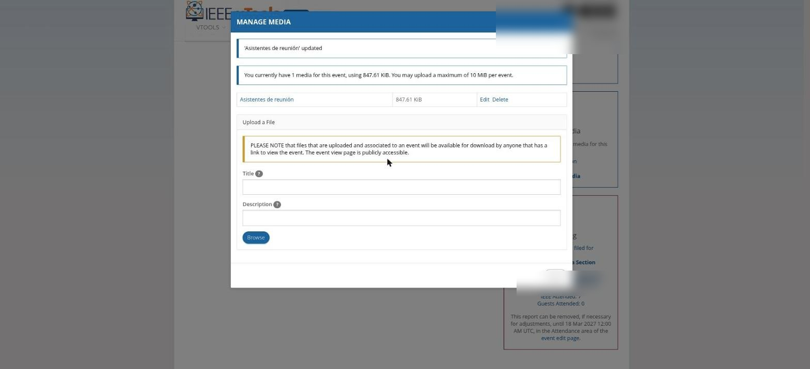{ loading=lazy }
  <figcaption>Archivo subido con su título.</figcaption>
</figure>

!!! warning ""

    **Privacidad:** los archivos de un evento se pueden descargar por cualquiera que tenga el enlace de la página pública. Revisa que la foto no tenga datos personales.

### Revisar la versión pública

En la página de administración, haz clic en **View** para ver lo que ve el público.

<figure markdown>
  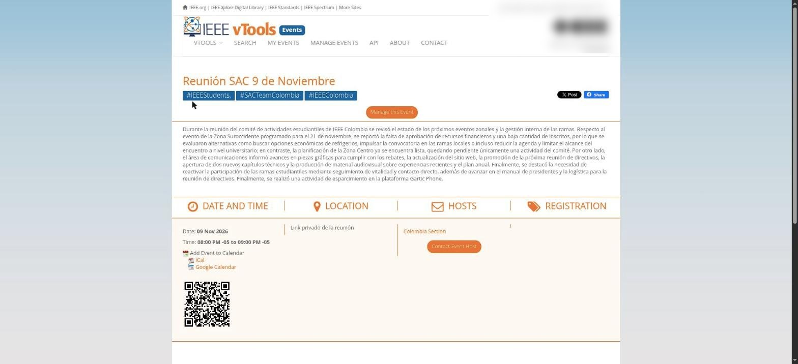{ loading=lazy }
  <figcaption>Versión pública del evento. El reporte y los archivos están en la vista de administración.</figcaption>
</figure>

Fuentes: [vTools Events](https://events.vtools.ieee.org/) y [Cómo reportar eventos en vTools (R9 SAC)](https://r9.ieee.org/sac/vtools-events/). Capturas de noviembre de 2026.
{ .sources }
