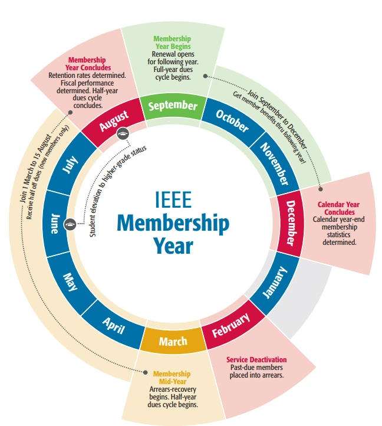

# Año de membresía

La membresía IEEE se renueva cada año. Toda la junta directiva debe conocer este calendario para planear las campañas de renovación: si los miembros no renuevan, la Rama puede quedar por debajo del mínimo de 12. El precio y cómo unirse están en [Cómo unirse a IEEE](../empezar/unirse.md).

{ loading=lazy }

| Mes | Qué pasa |
| --- | --- |
| **Septiembre** | Empieza el año de membresía y abre la renovación para el año siguiente. Quien se une entre septiembre y diciembre recibe beneficios hasta el final del año siguiente. |
| **Diciembre** | Cierra el año calendario y se calculan las estadísticas de miembros. Con esas cifras se calcula el rebate de la Rama. |
| **Febrero** | Se desactivan los servicios de quienes no renovaron. |
| **Marzo** | Mitad del año de membresía: de marzo a mayo se recuperan los miembros atrasados. Los miembros nuevos que se unen entre el 1 de marzo y el 15 de agosto pagan media cuota. |
| **Agosto** | Cierra el año de membresía. |

!!! warning ""

    **Buena práctica:** haz tu campaña de renovación entre septiembre y diciembre, para que tus miembros cuenten en las estadísticas de fin de año. Más ideas en [Plan de captación y renovación](plan-de-captacion.md).

## Corregir el grado o la Sección de un miembro

Un estudiante con el grado o la Sección equivocados puede no contar para tu Rama. Revisa tu lista de miembros en OU Analytics y, si ves un caso así, pídele al miembro que lo corrija:

- **Aparece como Member y no como Student Member:** debe actualizar su perfil educativo en su cuenta IEEE (universidad, programa y fecha esperada de graduación) y luego renovar como estudiante. [Ver pasos (IEEE Support Center)](https://supportcenter.ieee.org/app/answers/detail/a_id/824/).
- **Quedó en otra Sección:** puede pedir el cambio a una Sección vecina escribiendo a contiguous@ieee.org con su nombre, dirección, número de miembro, Sección actual y Sección deseada. [Ver detalle (IEEE Support Center)](https://supportcenter.ieee.org/app/answers/detail/a_id/1261/).

- [Unirse o renovar (precios vigentes)](https://www.ieee.org/membership/join)
- [Kit de campaña de renovación](https://brand-experience.ieee.org/toolkits/membership-renewal-toolkit)
- [Kits de desarrollo de membresía (MGA)](https://mga.ieee.org/membership-development/membership-development-kits)
- [Opción de pago grupal](https://www.ieee.org/membership/group-payment-option.html)
- [Validador de membresía (vTools)](https://vtools.ieee.org/membership-validator/)

Fuentes: [Portal de Desarrollo de Membresía (MGA)](https://mga.ieee.org/membership-development) · [IEEE Support Center](https://supportcenter.ieee.org/), consultados en noviembre de 2026.
{ .sources }
