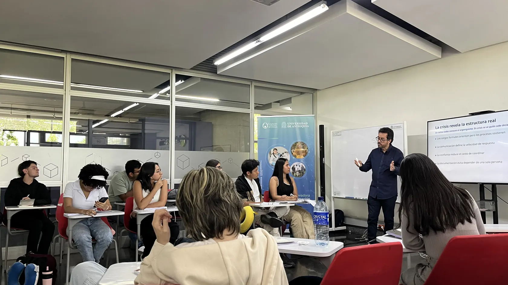

# Presidente de Rama

Dirige la Rama Estudiantil: gestiona un equipo de voluntarios, coordina las actividades y mantiene la Rama activa ante IEEE y ante la universidad.

{ loading=lazy }

## Descripción del cargo

- Presidir las reuniones de la Rama y reunir a la junta directiva con regularidad.
- Nombrar a los coordinadores de comités: programa, publicidad, membresía, finanzas y nominaciones.
- Entregar el reporte anual en vTools SB Reporting.
- Organizar cada año la elección de la nueva junta y reportarla en vTools Officer Reporting.
- Asegurar una transición ordenada de información y documentos a la junta nueva.
- Coordinar actividades con la Sección, la Región y otras Ramas cercanas.

Antes de aprobar un evento, la descripción del CLE sugiere preguntar: ¿atrae miembros nuevos?, ¿tenemos el tiempo, la gente y el dinero?, ¿responde a lo que necesitan los miembros actuales?

## Checklist recomendado

Basado en el plan de acción del CLE para este cargo. Marca lo que completes; el progreso se guarda solo en este navegador.

## Primeros 30 días

Empieza por [Tu primer mes como directivo](primer-mes.md). Además, como Presidente:

- [ ] Recibir las cuentas bancarias y actualizar las firmas autorizadas (quien deja el cargo sale como firmante, Manual MGA 9.8).
- [ ] Reportar a la nueva junta en [vTools Officer Reporting](https://officers.vtools.ieee.org/) si la junta saliente no lo hizo.
- [ ] Subir el Plan Anual en [vTools SB Reporting](https://sbr.vtools.ieee.org/) (fecha límite en [Reportes y fechas límite](../operar/reportes.md)).

## Tareas administrativas clave

- [ ] Conformar la junta directiva, revisar los roles y reunirse con ella.
- [ ] Decidir qué comités necesita la Rama y nombrar a sus coordinadores.
- [ ] Hacer el presupuesto de la Rama con el Tesorero.
- [ ] Coordinar con el Consejero.
- [ ] Organizar reuniones con agenda y acta (reglas de Robert, un procedimiento estándar para conducir reuniones).
- [ ] Planear y registrar el primer evento en [vTools Events](https://events.vtools.ieee.org/).
- [ ] Organizar premios, eventos y actividades como IEEEXtreme.
- [ ] Coordinar actividades con la Sección y la Región.
- [ ] Reclutar miembros y voluntarios.

!!! danger ""

    **No lo dejes para después:** el reporte de directivos, los reportes de reuniones y el Plan Anual vencen el **15 de marzo**. Si faltan, la Rama pierde el rebate. Ver [Reportes y fechas límite](../operar/reportes.md).

## Cursos recomendados

[Global Leadership Development](https://ieee-elearning.org/course/view.php?id=278), [Attracting and Retaining New Members](https://ieee-elearning.org/course/view.php?id=281), [Introduction to IEEE](https://ieee-elearning.org/course/view.php?id=239). [Ver todos los cursos del CLE](../aprender/catalogo-cursos-cle.md).

## En el CLE

[Plan de acción](https://ieee-elearning.org/course/view.php?id=267&section=13) ([First 30 Days](https://ieee-elearning.org/mod/checklist/view.php?id=1319) · [Key Administrative Items](https://ieee-elearning.org/mod/checklist/view.php?id=1320)) · [cursos recomendados](https://ieee-elearning.org/totara/program/required.php?id=3) · [descripción del cargo](https://ieee-elearning.org/mod/page/view.php?id=1998). Requiere cuenta IEEE.

Fuente: planes de acción y descripciones de cargo del Center for Leadership Excellence (CLE), consultados en noviembre de 2026.
{ .sources }
